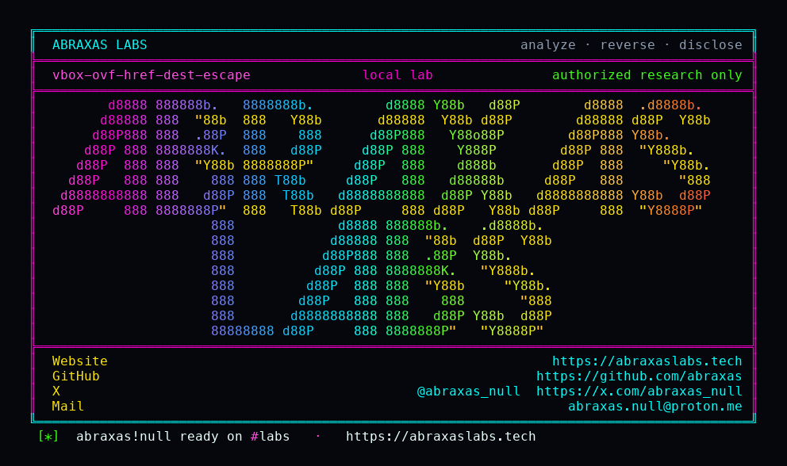

<p align="center">
  
</p>

<p align="center">
  <a href="https://abraxaslabs.tech"><strong>abraxaslabs.tech</strong></a>
  &nbsp;·&nbsp;
  <a href="https://github.com/abraxas">github.com/abraxas</a>
  &nbsp;·&nbsp;
  <a href="https://x.com/abraxas_null">@abraxas_null</a>
  &nbsp;·&nbsp;
  <a href="mailto:abraxas.null@proton.me">abraxas.null@proton.me</a>
  &nbsp;·&nbsp;
  <a href="https://github.com/abraxas/vbox-ovf-href-dest-escape">vbox-ovf-href-dest-escape</a>
</p>

# vbox-ovf-href-dest-escape

**Class:** File write
**Reach:** Local (host) UI:R

**Oracle VM VirtualBox OSS** `7.2.20` (`f2792cf44`) - Oracle

A host user who imports a hostile OVF/OVA writes disk-image bytes outside the new VM folder. `ovf:href` is the dest filename. `RTPathAbsExCxx` does not take `RTPATHABS_F_STOP_AT_BASE`. The unique-path helper inserts `_%i` before the suffix and does not basename-strip.

| | |
|---|---|
| ID | no CVE yet |
| Class | **File write** (OVF/OVA dest path) |
| Reach | **Local (host)** UI:R (victim imports a hostile appliance) |
| CWE | [CWE-22](https://cwe.mitre.org/data/definitions/22.html) |
| CVSS | **High: 7.8** `CVSS:3.1/AV:L/AC:L/PR:N/UI:R/S:U/C:H/I:H/A:N` |
| Product | [Oracle VM VirtualBox OSS](https://github.com/VirtualBox/virtualbox) |
| Affected | **7.2.20** (`f2792cf44f663989818507e36d3db5f978523c5e`) |
| Auth | none on VirtualBox. The host user opens File/Import or `VBoxManage import`. |
| License | [GNU Affero GPL v3.0](LICENSE) |
| Lab | `127.0.0.1` only. Source harness. VirtualBox is not booted. |

## What an attacker can do

Ship an OVF directory or an OVA. Put `../somewhere/disk.vmdk` or an absolute `/path/disk.iso` in `ovf:href`. The operator who imports it CREATE_REPLACE-writes those disk-image bytes as the importing UID, including parent directories that did not exist. Suffix required (`vmdk` / `iso` / other MediumFormat extensions). This is not a suffix-free drop of `authorized_keys`.

| Privilege | Method + sink | What it grants | Provenance |
|---|---|---|---|
| Integrity | `IAppliance::read` copies File/`href` with no basename strip (`ovfreader.cpp`). `Appliance::interpret()` sets dest = `di.strHref` (`ApplianceImplImport.cpp` 802-851). | Dest filename is attacker-chosen, including `../` and absolute paths. | Lab-proven (relative and absolute hrefs) |
| Integrity | `i_ensureUniqueImageFilePath` (`ApplianceImpl.cpp` 1126-1160) calls `RTPathAbsExCxx(strAbsName, aMachineFolder, aName)` with no `RTPATHABS_F_STOP_AT_BASE`. Collision inserts `_%i` before the suffix of `aName`, not a basename. | Unique dest still walks off the machine folder. `../oracle/WITNESS.vmdk` becomes `../oracle/WITNESS_1.vmdk`. | Lab-proven (`unique-keeps-dotdot=yes`) |
| Integrity | Import `i_importOneDiskImage` AbsEx again (`ApplianceImplImport.cpp` 4169-4171). `i_importCreateAndWriteDestinationFile` (1043-1053) mkdir-parents then `RTFILE_O_CREATE_REPLACE`. | Disk-image bytes land outside the VM folder. Absolute href ignores the machine folder. Control `disk.vmdk` stays in-folder. | Lab-proven (`relative-escape=yes` `absolute-href=yes` `control-in-folder=yes`) |
| Recon | Import wizard / `VBoxManage import --dry-run` shows the dest. | Path is visible. Not a secret leak by itself. | Inferred |
| Availability | Relative dest that lands on another VM's disk. | Overwrite that file as the importing UID. | Inferred (same CREATE_REPLACE write) |
| Closed | Dest with no MediumFormat suffix | Import throws `has no extension`. Not a suffix-free `authorized_keys` / crontab write. | Closed |
| Closed | NVRAM dest | Forced to `{vmname}.nvram` under the machine folder. | Closed |
| Closed | VM name `..` | `sanitiseMachineFilename` mangles it. | Closed |
| Closed | Shared folders / ExtraData / serial RawFile | Sanitized on the vbox:Machine path. | Closed |
| Closed | Host kernel, guest-to-host | Not this leftover. No VM start required. Same UID as the importer. | Closed |

OVA is the clean walk: tar member supplies the bytes, href supplies the escaped dest. No 3D, no Guest Additions, no VRDP, not PUEL.

## How I found it

I sat on tag `v7.2.20` (`f2792cf44`) after the Sep 2026 CPU and read OVF import. ExtraData, shared folders, NVRAM dest, and serial RawFile are already stripped. The disk dest is not. `interpret()` copies `di.strHref` straight into the HardDiskImage VBox value:

```cpp
Utf8Str strFilename = di.strHref;
/* ... */
i_ensureUniqueImageFilePath(strMachineFolder, devType, strFilename);
pNewDesc->i_addEntry(VirtualSystemDescriptionType_HardDiskImage,
                     hd.strDiskId,
                     di.strHref,
                     strFilename,
                     di.ulSuggestedSizeMB,
                     strExtraConfig);
```

`ApplianceImpl.cpp` 1126-1160 completes that name against the machine folder without `RTPATHABS_F_STOP_AT_BASE`, then mutates `aName` in place:

```cpp
int vrc = RTPathAbsExCxx(strAbsName, aMachineFolder, aName);
/* ... */
const char *pszSuffix = RTPathSuffix(aName.c_str());
offDashNum = pszSuffix ? (size_t)(pszSuffix - aName.c_str()) : aName.length();
aName.replace(offDashNum, cchDashNum, szTmp, cchTmp);
```

Import repeats AbsEx on the still-relative dest (`ApplianceImplImport.cpp` 4169-4171) and CREATE_REPLACE-writes. IPRT tests document the same join: absolute second argument wins; `/VirtualBox/Machines` plus `../VirtualBox.xml` is `/VirtualBox/VirtualBox.xml`.

Wrong turns already recorded: treating a suffix-free `authorized_keys` write as the leftover (import throws); NVRAM dest (forced in-folder); VM name `..` (sanitiser); shared folders / ExtraData / serial RawFile (already sanitized). Theatre: host kernel, guest-to-host. The oracle is a witness line outside the machine folder plus a control `disk.vmdk` that stayed put.

## Lab

```bash
python3 vbox-ovf-href-dest-escape-Abraxas-Labs.py
```

or

```bash
cd lab
./run.sh
```

Source harness of interpret dest-join, unique-path, and the import CREATE_REPLACE write. Docker compose, loopback, no VirtualBox binary. Machine folder `/work/Machines/ImportedVM`. Oracle `/work/oracle`.

```text
SUCCESS vbox-ovf-href-dest-escape relative-escape=yes unique-keeps-dotdot=yes absolute-href=yes control-in-folder=yes VBOX-OVF-HREF-DEST-ESCAPE-WITNESS
```

## The fix

Basename-strip `ovf:href` before it becomes a dest, or pass `RTPATHABS_F_STOP_AT_BASE` (and reject absolute names). Reject `RTPATH_PROP_DOTDOT_REFS`. Unique-path should mutate the basename, not the relative string.

## References

- [github.com/VirtualBox/virtualbox](https://github.com/VirtualBox/virtualbox) tag [v7.2.20](https://github.com/VirtualBox/virtualbox/releases/tag/v7.2.20) (`f2792cf44f663989818507e36d3db5f978523c5e`)
- [`ApplianceImplImport.cpp`](https://github.com/VirtualBox/virtualbox/blob/f2792cf44f663989818507e36d3db5f978523c5e/src/VBox/Main/src-server/ApplianceImplImport.cpp) 802-851, 1043-1053, 4169-4171
- [`ApplianceImpl.cpp`](https://github.com/VirtualBox/virtualbox/blob/f2792cf44f663989818507e36d3db5f978523c5e/src/VBox/Main/src-server/ApplianceImpl.cpp) 1126-1160
- [CWE-22](https://cwe.mitre.org/data/definitions/22.html)

## License

GNU Affero GPL v3.0. See [LICENSE](LICENSE). Loopback lab only. No warranty.
